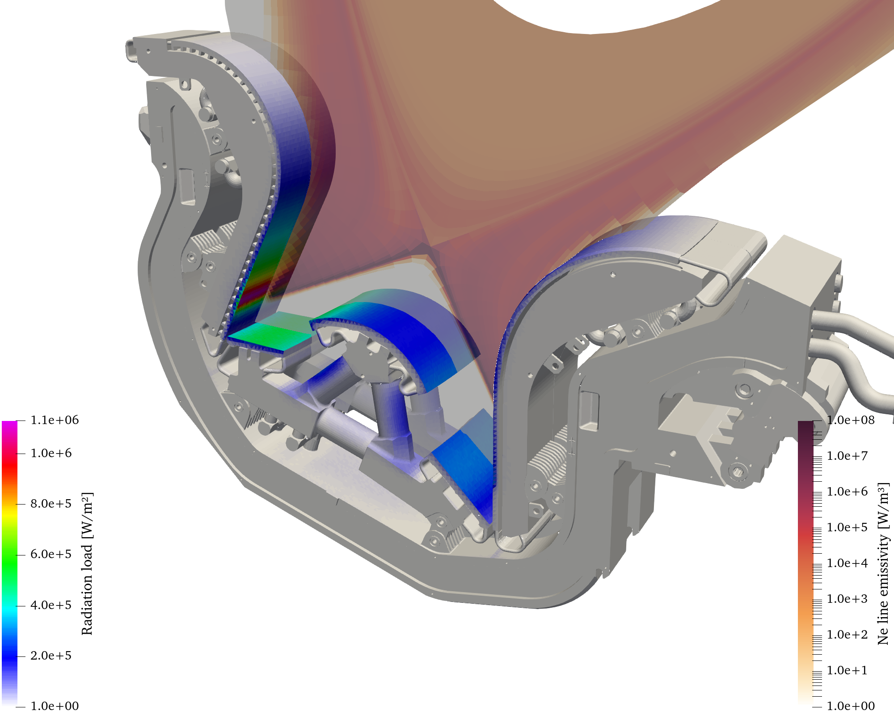

# IMAS radiation load

An IMAS-based workflow for calculating incident radiation loads on individual wall components.
IMAS IDSs define the component geometry and radiation inputs, and store the calculated loads and their uncertainties.
The current workflow reads geometry from a wall IDS and emissivity from a radiation IDS, traces rays with CHERAB and Raysect, and writes per-triangle power densities and Monte Carlo standard errors to a new wall IDS.



*Example component radiation-load distribution and plasma emissivity, visualized from IMAS data in ParaView.*

## Getting started

With [Pixi](https://pixi.sh) available, clone the repository:

```sh
git clone https://github.com/munechika-koyo/imas-radiation-load.git
cd imas-radiation-load
```

Run the commands below from the repository root.
Run a task with `pixi run <task>`; Pixi automatically prepares its dependencies when needed.
Task definitions are in [pixi.toml](pixi.toml).
The workspace declares Linux and macOS platforms.

Rendering requires accessible radiation and wall IDS inputs and an IMAS runtime with the corresponding backends.
Remote UDA access also requires the server configuration and credentials provided by your site.
Slurm submission requires `sbatch`, Pixi and the input data to be available on the HPC system; compute nodes must also be able to access the repository and run directory.

Local development and visualization can use a separate checkout from the HPC checkout.
Keep machine-specific configuration in `configs/local*.toml`, which is ignored by Git.
The published runtime currently supports `emitter.kind = "radiation_ids"`; plasma and spectral emission workflows are outside the scope of this guide.

## Workflow

1. Provide an existing component wall IDS, or create one from STL files once with `prepare-wall`.
2. Configure the radiation source, scene geometry, sampling, output URI and Slurm resources.
3. Run `check-config` and `validate`, then inspect the saved scenegraph.
4. Run one component directly with `render`, or submit all components as separate Slurm jobs with `submit`.
5. Assemble the component results into one wall IDS. Slurm submission schedules this merge automatically with an `afterok` dependency.
6. Open the result and error previews with `view-results` and `view-errors`.

## Input data and configuration

Each emission source has an independent, annotated example configuration:

| Example configuration | `emitter.kind` | Emission source | Public workflow status |
| --- | --- | --- | --- |
| [plasma-spectral.toml](configs/plasma-spectral.toml) | `plasma_spectral` | Spectral emission from IMAS plasma profiles | Configuration loading only |
| [plasma-total.toml](configs/plasma-total.toml) | `plasma_total` | Total emission from IMAS plasma profiles using PLT and PRB coefficients | Configuration loading only |
| [radiation-ids.toml](configs/radiation-ids.toml) | `radiation_ids` | Emission from radiation IDS | Rendering workflow available |

Each example includes its own geometry, rendering, output and Slurm settings.
Copy the example for the intended source to a machine-specific configuration and edit it for the run.
The commands below use the radiation IDS example, which is supported by the current public workflow:

```sh
cp configs/radiation-ids.toml configs/local-radiation.toml
```

Edit the copy before running a calculation; the supplied input URIs are placeholders.
Keep calculation parameter values in the workflow TOML and task argument defaults in [pixi.toml](pixi.toml).
Refer to those files for current values when configuring a run.

| Section | What to configure |
| --- | --- |
| `[emitter]` | Keep `kind = "radiation_ids"`; set the volume integration step in metres |
| `[radiation]` | Emissivity representation, process selection, time tolerance and interpolator caching |
| `[radiation.primary]` | Radiation URI, requested time, occurrence and optional IMAS `DBEntry` options |
| `[radiation.secondary]` | Optional complementary core/GGD radiation source |
| `[geometry.target]` | Component wall URI, description index, occurrence, geometry time and toroidal repetition |
| `[[geometry.non_targets]]` | Optional named wall geometries that absorb and occlude rays |
| `[render]` | Sampling, convergence threshold, pass limit, save interval and observer surface offset |
| `[output]` | New HDF5 entry URI, occurrence and optional persistent intermediate storage |
| `[slurm]`, `[slurm.merge]` | Job template, working directory, resources and logging |

### Radiation source

Set `radiation.primary.uri`, `time` and `occurrence` to an accessible radiation IDS.
For example, the URI may use `imas:hdf5?path=/absolute/path/to/entry` for direct filesystem access or `imas:uda?path=/remote/path/to/entry` for remote access.
When moving a configuration to the HPC system, use the backend and paths available there; an input accessible directly through HDF5 does not need UDA transport.

Omit `[radiation.secondary]` for a single source.
Two sources must supply complementary core/GGD emission and use `emissivity_source = "values"`.
If secondary time is omitted, it inherits primary time.
Omitting `process_indices` sums the available processes; choose mutually exclusive processes to avoid double counting.
The actual selected input times are recorded with the calculation.

### Scene geometry

Each named face `grid_subset` in the target wall defines a component; there is no separate mesh-list argument.
During rendering, the selected reference component is registered as a `MeshCamera` observer.
Other geometry absorbs and occludes rays.

`num_segments` is the total number of equally spaced toroidal placements, including the original.
Only components in the original target segment are measured; replicated segments provide occlusion.
Set this value independently for the target and each non-target source, accounting for whether the supplied geometry already spans the full torus.
Remove the example `[[geometry.non_targets]]` table if no additional geometry is needed.

### Paths and output storage

Paths inside the TOML, including an IMAS URI's `path` parameter, are resolved relative to the configuration file.
Task arguments such as a configuration path, work directory or output URI override are resolved relative to the command's current directory.
Quote URI arguments in shell commands because query separators such as `&` have shell meanings.

Set `output.uri` to a new local HDF5 entry using the form `imas:hdf5?path=...`.

The output entry must not already exist; tasks refuse to overwrite it.
The parent directory may exist.
Without `output.work_directory` or an explicit run-directory argument, intermediate files are created in a temporary sibling directory of the final entry and removed after a successful merge.
Failed runs retain their intermediate files.
Set `output.work_directory` to a persistent parent directory, or pass an explicit run directory to `submit`, to retain intermediate results and logs after success.

## Prepare wall geometry

Skip this step when a suitable component wall IDS already exists.
Otherwise, place one STL file per component directly in a directory and run:

```sh
pixi run prepare-wall data/stl_parts data/component-wall
```

The second argument is a new output directory, not an IMAS URI.
Use `imas:hdf5?path=../data/component-wall` for `geometry.target.uri` in a configuration under `configs/`.

STL basenames become component names; use letters, numbers, underscores or hyphens.
Choose the coordinate scaling argument to convert the STL units to metres.
Scaling, normal reversal and the IMAS data-dictionary version are task arguments defined in [pixi.toml](pixi.toml).

Preparation uses Raysect's STL importer, welds exactly matching vertices and always removes duplicate triangles within each component, including duplicates with reversed winding.
It stores a shared Cartesian grid and a face subset for each component.
The task prints the created wall URI and the geometry selection information to use in the rendering configuration.

## Validate before rendering

First check configuration structure and parameter values without loading the IDS inputs:

```sh
pixi run check-config configs/local-radiation.toml
```

Then exercise input loading, scene construction, observer initialization, intermediate result I/O, merge and an HDF5 write/read round trip:

```sh
pixi run validate configs/local-radiation.toml
```

Validation prints the report directory and the path to `scenegraph.txt` rather than dumping the scenegraph to the terminal.
When `report_dir` is omitted, each validation creates a unique run directory under the report parent configured in [pixi.toml](pixi.toml), resolved relative to the task's working directory.
Reports are retained after both successful and failed validation.
An explicit `report_dir` selects an exact new directory and is never overwritten.
Inspect this file to confirm reference geometry, `copy_segment_*` nodes, non-target geometry and the representative observer.
`validation.json` records the completed stages, while `inputs.json` records input identities.
The I/O check uses synthetic values in a separate sandbox and does not create a production output entry.
This sandbox is created beside the configured final output to check that filesystem and backend; it is removed after a successful round trip and retained for inspection if the check fails.

The optional `probe_samples` argument controls a bounded ray-tracing check.
Replace `PROBE_SAMPLES` below with the desired total primary-sample budget:

```sh
pixi run validate configs/local-radiation.toml PROBE_SAMPLES results/validation-check
```

The budget is shared across components and distributed over representative faces.
If the budget is smaller than the number of components, some components are not ray-traced; the report identifies them.
This probe checks execution, not production convergence or the accuracy of every face.
Run validation explicitly before rendering or submission; neither task automatically invokes it.

## Run calculations

### One component without Slurm submission

Replace `component_name` with a target wall subset name:

```sh
pixi run render component_name configs/local-radiation.toml \
  "imas:hdf5?path=results/component-check"
```

This runs without Slurm and writes a separate result entry.
It is useful for a trial calculation or a calculation that can run in the current allocation.
Only the selected component receives calculated values; other component subsets remain in the output geometry with empty values.
Omit the output override to use `output.uri`.
Use the optional worker-count argument to control parallelism; see the task definition for its fallback behavior.

### All components through Slurm

On the HPC checkout, adjust the input paths, output URI, partition, time limit and CPU allocation in the configuration.
`slurm.working_directory` must identify that checkout, and `slurm.job_template` normally points to [jobs/slurm.sh.j2](jobs/slurm.sh.j2).
Add any required site-specific module setup to the template before submission.

Generate concrete scripts for review without submitting jobs:

```sh
pixi run submit preview configs/local-radiation.toml results/slurm-preview
```

Preview loads the target wall geometry and freezes the run configuration.
It writes one script per component, a merge script and `jobs.json`; the merge script contains a pending dependency placeholder.
After inspecting the scripts, submit a fresh run with a different, new directory:

```sh
pixi run submit submit configs/local-radiation.toml results/slurm-run
```

Submission creates one component job per target subset and one merge job dependent on all component jobs through `afterok`.
Each generated script runs a Pixi task; it does not activate a separate Python CLI.
`jobs.json` records the job IDs, and logs are written under the run directory unless Slurm log paths are configured explicitly.
Submit mode also stores a durable record beside the output entry, named `<entry-name>.submission.json`.
It retains the job IDs, submission time, reported cluster, work directory and log paths after temporary workspace cleanup.
An existing submission record prevents a new submission to the same output URI; choose a new output URI for a new run.
Preview mode keeps its record in the preview work directory and does not reserve the final output's submission record.
The explicit run directory in this example is retained after merge.
If a component job fails, the dependency prevents the automatic merge from running.

### Monitor submitted jobs

Run on the HPC login node with the same configuration used for submission:

```sh
pixi run status configs/local-radiation.toml
pixi run status configs/local-radiation.toml watch
```

The task locates the durable submission record from `output.uri`, queries active jobs with `squeue` and retrieves finished-job accounting with `sacct`.
It displays each component and the merge stage, job IDs, Slurm states, elapsed times, exit codes, nodes and waiting reasons.
Rich tables distinguish job states with colors and emoji, and adapt their columns to the terminal width.
Saved pass counts and convergence come from component checkpoints, or from the final `rendering.json` after merge.
The saved pass is the last checkpoint, rather than live ray-tracing progress; Slurm `COMPLETED` and calculation convergence are displayed separately.

Watch mode stops after all submitted jobs reach terminal states; Ctrl+C stops the display without affecting jobs.
In an interactive terminal, watch refreshes the table in place; redirected output keeps readable snapshots without terminal control sequences.
Its optional interval argument and query timeout are defined in [pixi.toml](pixi.toml).
Missing accounting records are shown as `UNKNOWN`, never inferred to mean success.
If Slurm queries fail, the task reports the problem and stops watching rather than claiming that jobs finished.
The status task is read-only and does not load IDS data.

Durable records are created by submissions made with this version of the workflow.
Older runs with only a work-directory `jobs.json` are not automatically discovered.
Retaining log paths does not retain log files inside a temporary workspace; configure persistent Slurm log paths or retain the work directory when those logs are needed after success.

### Merge retained results

For a retained run whose component results are all finished, merge uses the frozen configuration in that run:

```sh
pixi run merge results/slurm-run
```

This is normally handled automatically after submission.
Manual merge requires a new output entry and checks component identities, triangle order, source information and calculation settings before assembly.
It does not replace missing or unfinished component results with zeros.

## Outputs and uncertainty

A completed output entry contains:

```text
output-entry/
├── master.h5
├── wall.h5
├── rendering.json
└── vtk/
    ├── component_a.vtk
    └── component_b.vtk
```

The wall IDS preserves the reference geometry and associates each measured component's per-triangle power density with its `grid_subset`.
Results are stored under `description_ggd → ggd → power_density`, with symmetric standard errors in `values_error_upper` and `values_error_lower`.
Both power density and its error use W/m².
Each component VTK contains cell arrays named `PowerDensity` and `PowerDensityError`.

Rendering stops when the adaptive sampler converges or `render.max_passes` is reached.
Set the pass limit and convergence threshold in the workflow TOML.
Reaching the pass limit still saves the current estimates and errors and allows the component job to finish successfully.
**A successful job or merge does not imply convergence.**

Inspect `rendering.json` for each component's `converged` flag, stopping reason, pass count and minimum/maximum sample counts.
The uncertainty is a **1-sigma Monte Carlo standard error of the mean**, not an estimate of geometry or emission-model uncertainty.
Relative error is `100 * PowerDensityError / abs(PowerDensity)` in percent.
When the estimated load is zero, relative error is undefined; the error preview shows those faces in gray.

The calculation models incident radiation on absorbing, non-emitting surfaces.
Particle heat flux, wall thermal emission and reflection are not included.

## Visualization

### Result and error previews

Use the same rendering configuration to open its output wall URI and radiation source:

```sh
pixi run view-results configs/local-radiation.toml
pixi run view-errors configs/local-radiation.toml relative
pixi run view-errors configs/local-radiation.toml absolute
```

`view-errors` reads all measured component VTK files listed in the output entry's `rendering.json` and groups them in one scene.
Choose `relative` for relative standard error [%] or `absolute` for standard error [W/m²].
It does not need to open the radiation IDS.

To visualize downloaded HPC results locally, make a local copy of the rendering configuration and update `output.uri` and the input URIs to accessible local or remote locations.
Copy the whole output directory, including `vtk/` and `rendering.json`, rather than only the HDF5 files.

The result preview requires exactly one GGD radiation source and a common wall/radiation time slice.
The result state's selected emissivity array must be available in the radiation IDS; adjust the state template when needed.
The GGD reader does not apply arbitrary radiation `DBEntry` kwargs.

### Export images

Export to the rendering output entry without specifying a separate destination:

```sh
pixi run view-results configs/local-radiation.toml export
pixi run view-errors configs/local-radiation.toml relative export
```

Exports reuse a fixed directory beneath the output IMAS entry's visualization subdirectory and print its location.
The subdirectory name is configured in [pixi.toml](pixi.toml).
Result and error previews use separate `view-results` and `view-errors` directories.
Each invocation overwrites the matching images, PVSM states and report in that directory.
An explicit `output_dir` selects a directory elsewhere and also allows existing exports to be overwritten.

`view-results` exports each camera in [radiation-load.pvcvbc](configs/paraview/radiation-load.pvcvbc) with both linear and logarithmic radiation-load colors.
The side view uses orthographic projection; the other saved views retain perspective projection.
Images and matching PVSM states are named `radiation-load-<viewpoint>-<scale>.png` and `.pvsm`, with a shared `report.json` recording camera settings, color ranges and image dimensions.
The emissivity color scale remains as defined in the state template.
Log exports preserve a positive lower color limit saved in the PVSM, while retaining the upper limit selected by the state's rescaling policy.
If the saved lower limit is nonpositive, the smallest positive data value is used instead; save a positive lower color limit in the state to keep negligible values from stretching the logarithmic range.
Values below the logarithmic lower limit, including zero load, use the color map's below-range color.
An entirely nonpositive field cannot be exported logarithmically and produces a clear error.

Image dimensions and scalar-bar typography are defined together in the shared PVSM, and screenshots use that resolution with proportional font scaling.
Log exports use ParaView's automatic logarithmic axis with decade labels and intermediate minor ticks; linear exports preserve the template's label settings.
Exported result PNGs have a transparent background; geometry, color bars and labels retain the template's colors and opacity.
Adjust those properties in ParaView and save a custom state to change the export formatting.
The optional final `viewpoints` argument selects a different native custom-viewpoint file.

`view-errors` exports the same saved cameras with linear colors for the chosen error quantity, including orthographic projection for the side view and transparent PNG backgrounds.
Images and matching states are named `radiation-error-<quantity>-<viewpoint>-linear.png` and `.pvsm`; `report.json` records the latest export, including camera, scalar-bar and color-range settings.
Error color ranges and typography come from [radiation-errors.pvsm](configs/paraview/radiation-errors.pvsm), which hides the orientation axes by default.
Undefined relative errors at zero load retain the template's NaN color.
Both preview tasks accept the optional final `viewpoints` argument to select another native camera-preset file.
GUI mode saves `scene.png`, `scene.pvsm` and `report.json` when an explicit output directory is supplied.

### Layouts, colors and saved views

The shared states are [radiation-load.pvsm](configs/paraview/radiation-load.pvsm) and [radiation-errors.pvsm](configs/paraview/radiation-errors.pvsm).
They store camera, layout, color-map and scalar-bar settings; the tasks bind the data sources from the rendering configuration.
There is no separate visualization TOML.

Adjust the scene in ParaView and save a new state, then pass it as the final task argument:

```sh
pixi run view-results configs/local-radiation.toml gui "" path/to/custom-results.pvsm
pixi run view-errors configs/local-radiation.toml relative gui "" path/to/custom-errors.pvsm
```

Preserve the named pipeline objects used for data binding when editing a state.
For results, these include `wall IDS`, `radiation IDS`, `Radiation load components` and `Emissivity cells`.
For errors, preserve `All components`, `Absolute error` and `Relative error`.

The tasks import the bundled UltraPlot Fire and Fire_r color presets, which can also be selected through the GUI preset chooser.
Custom viewpoint buttons are stored separately from PVSM files; import [radiation-load.pvcvbc](configs/paraview/radiation-load.pvcvbc) through **Configure custom viewpoints → Import**.
To open a general ParaView session with the IMAS plugin enabled, use `pixi run paraview`.

## Task reference

The table below summarizes the public entry points; [pixi.toml](pixi.toml) defines the positional arguments and their defaults.
Arguments are supplied to Pixi tasks rather than directly to Python scripts.

| Task | Purpose |
| --- | --- |
| `prepare-wall` | Create a component wall IDS from STL files once |
| `check-config` | Check configuration without opening input data; optionally save resolved settings |
| `validate` | Check the scene and result I/O, with an optional bounded ray probe |
| `render` | Calculate one named component without Slurm submission and save its final entry |
| `submit` | Preview scripts or submit all component jobs and their dependent merge |
| `status` | Show submitted job states and saved calculation progress, once or continuously |
| `render-component` | Worker subtask invoked by generated component job scripts |
| `merge` | Assemble a finished run into one wall entry |
| `view-results` | Open or export the wall load and radiation-emissivity scene |
| `view-errors` | Open or export absolute or relative component errors |
| `paraview` | Open ParaView with IMAS plugins |
| `lint` | Check workflow Python scripts with Ruff |

List available tasks with:

```sh
pixi task list
```

For development checks, run `pixi run lint`.

## Troubleshooting

| Symptom | What to check |
| --- | --- |
| Configuration loads, but input loading fails | `check-config` does not open data. Check backend availability, URI, occurrence, requested time, remote credentials and the full `validate` report |
| Output already exists | Choose a new output entry. Also use new explicit validation, submit and visualization output directories |
| Unexpected geometry or duplicated measurements | Inspect `scenegraph.txt`, target subset names and `num_segments`. Replicated target segments provide occlusion only |
| Preview scripts work locally, but jobs fail on HPC | Check compute-node access to Pixi, the checkout, the run directory and all inputs; add site setup to the Slurm template if needed |
| Merge does not run after submission | Check job IDs and logs. `afterok` requires successful component jobs, and merge also requires complete, matching results |
| Status cannot find a submission record | Use the submitted run's output URI. Preview and older runs do not create the durable record |
| Status shows `UNKNOWN` | Check Slurm access and accounting availability on the submitting cluster; missing records do not establish completion |
| Results exist but errors remain large | Inspect convergence and pass counts in `rendering.json`; the pass limit permits saving unconverged estimates |
| Relative-error faces are gray | Estimated power density is zero, so relative error is undefined |
| Result preview reports a missing emissivity field | Select an array present in your radiation IDS and save an adjusted template, using the IMAS-enabled ParaView session |
| ParaView uses a different installation or lacks IMAS readers | Launch through `pixi run paraview`, `view-results` or `view-errors` in this workspace |

Input datasets, calculation results and local configurations are excluded from Git.
The README illustration is kept separately under `docs/images/`.
